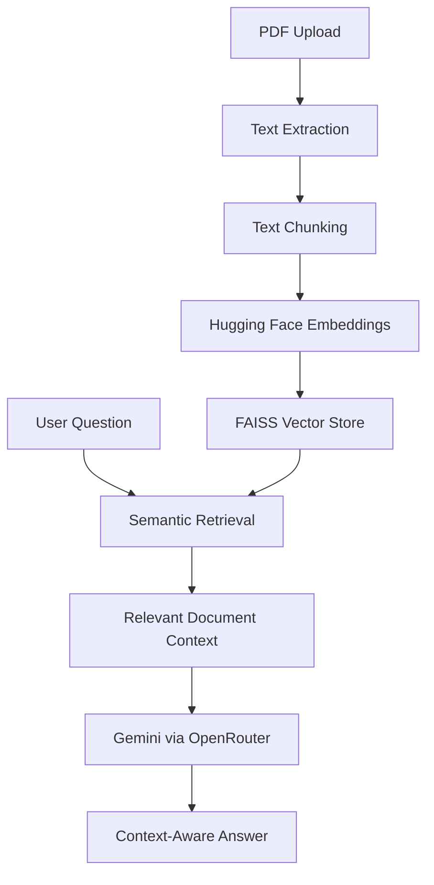

# Folio — AI-Powered PDF Assistant

**Chat with your documents. Understand them faster.**

Folio is an AI-powered PDF summarization and question-answering application built using Retrieval-Augmented Generation (RAG). It lets users upload PDF documents, generate summaries, and ask questions in natural language.

Rather than manually searching through lengthy documents, Folio retrieves relevant information and uses an LLM to generate context-aware responses.

## Features

- **PDF Upload** — Upload PDF documents for processing.
- **AI Summarization** — Generate concise summaries of document content.
- **Conversational Q&A** — Ask questions about uploaded documents.
- **RAG Pipeline** — Ground responses in retrieved document content.
- **Semantic Search** — Find relevant passages using vector similarity.
- **FAISS Vector Store** — Store and retrieve document embeddings.
- **User Authentication** — Sign up, log in, and manage accounts.
- **Chat History** — Manage saved conversations.
- **Profile Management** — Maintain user profile information.

## Tech Stack

| Component | Technology |
|---|---|
| Backend | Python, Flask |
| Frontend | HTML, CSS, JavaScript |
| LLM | Google Gemini via OpenRouter |
| RAG Framework | LangChain |
| Embeddings | Hugging Face Sentence Transformers |
| Vector Store | FAISS |
| PDF Processing | PyPDF |
| Database | SQLite, Flask-SQLAlchemy |
| Testing | Pytest |

## How It Works

Folio uses a Retrieval-Augmented Generation pipeline to answer questions using information from uploaded PDFs.



### RAG Pipeline

1. **Document Ingestion:** Extract text from uploaded PDF files.
2. **Text Chunking:** Split extracted text into smaller, overlapping chunks.
3. **Embedding Generation:** Convert text chunks into numerical vector representations.
4. **Vector Storage:** Store embeddings in a FAISS index.
5. **Retrieval:** Retrieve relevant document chunks based on the user's question.
6. **Response Generation:** Pass the retrieved context to the language model to generate an answer.

## Getting Started

### Prerequisites

- Python 3.10 or later
- pip
- An OpenRouter API key

### 1. Clone the repository

```bash
git clone https://github.com/Code-by-Manik/Folio-PDF-Summarizer.git
cd Folio-PDF-Summarizer
```

### 2. Create a virtual environment

**Windows PowerShell:**

```powershell
python -m venv .venv
.venv\Scripts\Activate.ps1
```

**Linux / macOS:**

```bash
python -m venv .venv
source .venv/bin/activate
```

### 3. Install dependencies

```bash
pip install -r requirements.txt
```

### 4. Configure environment variables

Create a `.env` file in the project root:

```env
OPENROUTER_API_KEY=your_openrouter_api_key
OPENROUTER_MODEL=google/gemini-2.5-flash
SECRET_KEY=your_secure_random_secret
```

Get your API key from [OpenRouter](https://openrouter.ai/).

**Important:** Never commit your `.env` file or expose API keys publicly.

### 5. Run the application

```bash
python app.py
```

Open the application in your browser:

http://127.0.0.1:5000

## Running Tests

Run the backend test suite with:

```bash
python -m pytest tests/ -v
```

## Project Structure

```text
Folio-PDF-Summarizer/
│
├── app.py
├── requirements.txt
├── .gitignore
├── run_backend.bat
├── test_app.py
├── verify_backend.py
│
├── notebooks/
│   └── AI_PDF_QA_RAG_Gemini.ipynb
│
├── static/
│   ├── app.js
│   └── style.css
│
├── templates/
│   ├── Index.html
│   └── profile.html
│
└── tests/
    └── test_backend.py
```

## Roadmap

- [ ] Deploy the application to the cloud.
- [ ] Add persistent document storage.
- [ ] Improve multi-document retrieval.
- [ ] Add more detailed source references to answers.
- [ ] Introduce document comparison and analysis.
- [ ] Strengthen production security and scalability.

## Author

**Manik Aggarwal**

- GitHub: [@Code-by-Manik](https://github.com/Code-by-Manik)
- Project: [Folio — PDF Summarizer](https://github.com/Code-by-Manik/Folio-PDF-Summarizer)

---

<p align="center">
  <strong>Folio</strong> — Making document understanding faster and smarter.
</p>
